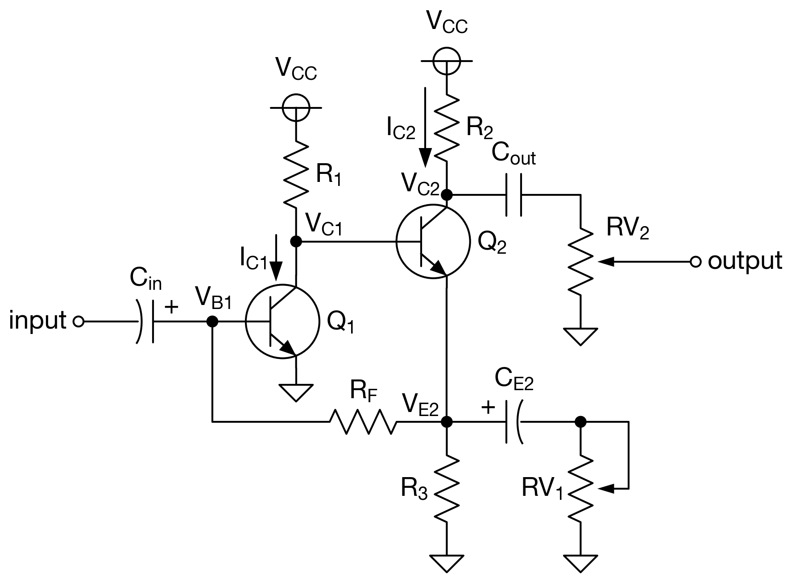
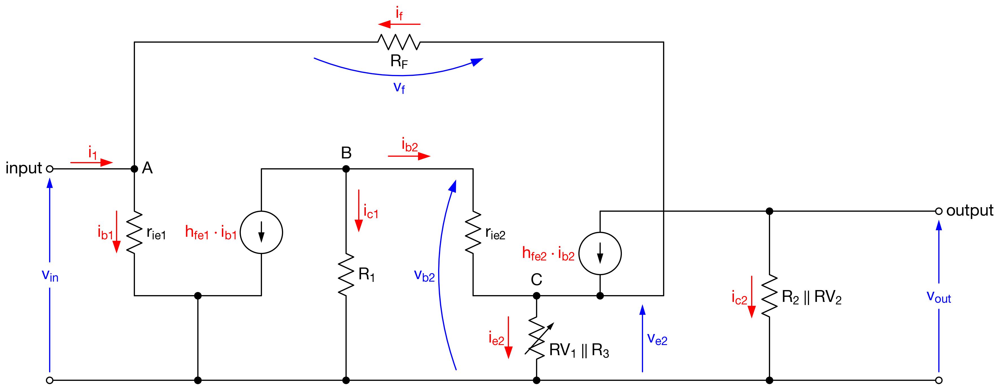
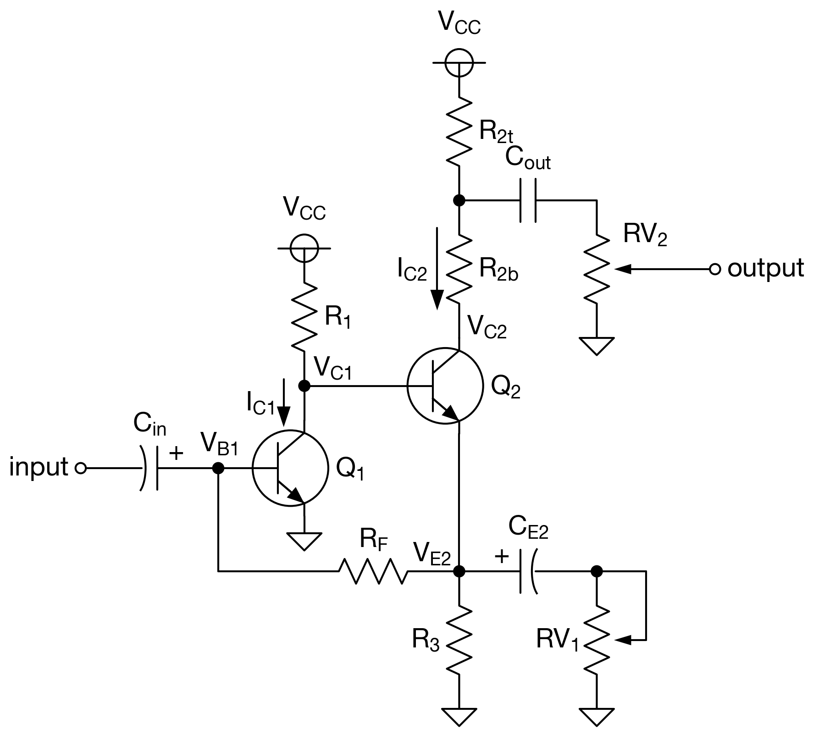

# Fuzz Face Operating Point Calculator

Fuzz Face 回路の動作点を SPICE モデルパラメータに基づいて解析する Web アプリケーションです。（Claude Opus 4.6を用いて作成）

## 回路図



## 目次

- [概要](#概要)
- [動作点の計算](#動作点の計算)
  - [トランジスタモデル](#1-トランジスタモデルgummel-poon)
  - [順方向計算](#2-順方向計算forward)
  - [逆計算](#3-逆計算reverse--newton-raphson)
- [交流解析](#交流解析)
  - [電圧利得](#電圧利得-a_v)
  - [入力インピーダンス](#入力インピーダンス-z_in)
- [最適動作点条件と R₂ の導出](#最適動作点条件と-r₂-の導出)
- [R₂ 分圧器](#r₂-分圧器divider)
- [ファイル構成](#ファイル構成)

---

## 概要

本ツールは 2 つの計算モードを提供します。

| モード | 入力 | 出力 |
|--------|------|------|
| **順方向 (Forward)** | 目標コレクタ電流 $I_{C1}, I_{C2}$ | バイアス抵抗 $R_1, R_2, R_3$ |
| **逆計算 (Reverse)** | 抵抗値 $R_1, R_{2t}, R_{2b}, R_3$ | コレクタ電流 $I_{C1}, I_{C2}$ |

両モードとも、計算結果から **ノード電圧**・**動作点**・**AC 解析（電圧利得・入力インピーダンス）**・**出力電圧配分** を表示します。

---

## 動作点の計算

### 1. トランジスタモデル（Gummel-Poon）

コレクタ電流 $I_C$ が与えられたとき、SPICE パラメータから以下を算出します。

**ベース・エミッタ間電圧：**

$$V_{BE} = V_T \ln\!\left(\frac{I_C}{I_S}\right)$$

**ベース電流（理想成分 ＋ 再結合リーク成分）：**

$$I_B = \underbrace{\frac{I_S}{B_F}\!\left(e^{V_{BE}/V_T} - 1\right)}_{\text{ideal}} + \underbrace{I_{SE}\!\left(e^{V_{BE}/(N_E V_T)} - 1\right)}_{\text{recombination}}$$

**実効電流増幅率：**

$$\beta_{\text{eff}} = \frac{I_C}{I_B}$$

**入力インピーダンス $r_{ie}$ （$= h_{ie}$）：**

$$r_{ie} = R_B + \frac{\beta_{\text{eff}} \cdot N_F \cdot V_T}{I_C} + (1 + \beta_{\text{eff}}) \cdot R_E$$

> ここで $R_B, R_E$ は SPICE モデルの内部ベース・エミッタ抵抗、$N_F$ は理想係数です。

---

### 2. 順方向計算（Forward）

目標コレクタ電流 $I_{C1}, I_{C2}$ から、最適動作点を実現する **バイアス抵抗 $R_1, R_2, R_3$** を求めます。

#### 回路方程式（KCL / KVL）

$$
\begin{align}
I_{B1} &= I_F & &\text{(Q1 ベース = 帰還電流)}\\
I_3 &= (I_{C2} + I_{B2}) - I_{B1} & &\text{(Q2 エミッタの KCL)}\\
V_{BE1} + I_F R_F &= I_3 R_3 & &\text{(Q1 ベースループの KVL)}\\
V_{C1} &= V_{E2} + V_{BE2} & &\text{(Q1 コレクタ = Q2 ベース)}\\
I_1 &= I_{C1} + I_{B2} & &\text{(R1 を流れる電流)}\\
V_{CC} &= I_1 R_1 + V_{C1} & &\text{(電源ループの KVL)}
\end{align}
$$

#### Step 1 : $R_3$

$$R_3 = \frac{V_{BE1} + I_{B1} \cdot R_F}{I_3}, \qquad V_{E2} = I_3 R_3$$

#### Step 2 : $R_1$

$$R_1 = \frac{V_{CC} - (V_{E2} + V_{BE2})}{I_{C1} + I_{B2}}$$

#### Step 3 : $R_2$（[詳細は後述](#最適動作点条件と-r₂-の導出)）

最適動作点条件 $V_R : V_{CE2} = (1 + R_2/RV_2) : 1$ を満たす 2 次方程式の正の解として求まります。

---

### 3. 逆計算（Reverse — Newton-Raphson）

抵抗値 $R_1, R_2, R_3$ が既知の場合、非線形連立方程式を Newton-Raphson 法で解いて $I_{C1}, I_{C2}$ を求めます。

#### 残差関数

$$
\begin{cases}
f_1(I_{C1}, I_{C2}) = V_{BE1} + I_{B1} R_F - \bigl[(I_{C2} + I_{B2}) - I_{B1}\bigr] R_3 = 0 \\[6pt]
f_2(I_{C1}, I_{C2}) = V_{CC} - R_1 (I_{C1} + I_{B2}) - \bigl[(I_{C2} + I_{B2}) - I_{B1}\bigr] R_3 - V_{BE2} = 0
\end{cases}
$$

> $V_{BE}, I_B$ はそれぞれ $I_C$ の関数（上記 Gummel-Poon モデル）。

#### ヤコビアン（数値微分）

$$J = \begin{pmatrix} \partial f_1/\partial I_{C1} & \partial f_1/\partial I_{C2} \\ \partial f_2/\partial I_{C1} & \partial f_2/\partial I_{C2} \end{pmatrix}$$

各偏微分は差分 $h = 10^{-10}$ を用いて数値的に近似し、ニュートンステップ

$$\begin{pmatrix}\Delta I_{C1} \\ \Delta I_{C2}\end{pmatrix} = -J^{-1} \begin{pmatrix} f_1 \\ f_2 \end{pmatrix}$$

にダンピング（$\alpha$ を半減させて $I_C > 0$ を保証）を適用します。  
収束条件は $|f_1|, |f_2| < 10^{-12}$、最大反復回数は 200 回です。

---

## 交流解析



小信号等価回路から **電圧利得** $A_v$ と **入力インピーダンス** $Z_{in}$ を求めます。

### 変数定義

$$R_E = RV_1 \parallel R_3, \qquad R_C = R_2 \parallel RV_2$$

### KCL 方程式

| No. | ノード | 式 |
|-----|--------|-----|
| K1 | 点 A | $i_1 + i_f = i_{b1}$ |
| K2 | 点 B | $h_{fe1}\, i_{b1} + i_{b2} + i_{c1} = 0$ |
| K3 | 点 C | $(1 + h_{fe2})\, i_{b2} = i_{e2} + i_f$ |
| K4 | 点 D | $i_{c2} = -h_{fe2}\, i_{b2}$ |

### オームの法則

| No. | 区間 | 式 |
|-----|------|-----|
| O1 | A–GND | $v_{in} = r_{ie1}\, i_{b1}$ |
| O2 | B–GND | $v_{b2} = R_1\, i_{c1}$ |
| O3 | B–C | $v_{b2} - v_{e2} = r_{ie2}\, i_{b2}$ |
| O4 | C–GND | $v_{e2} = R_E\, i_{e2}$ |
| O5 | C–A | $i_f = (v_{e2} - v_{in}) / R_F$ |
| O6 | OUT–GND | $v_{out} = R_C\, i_{c2}$ |

### 電圧利得 $A_v$

$i_{b2}$ を $v_{in}$ で表し、$v_{out} = -R_C\, h_{fe2}\, i_{b2}$ に代入することで：

$$\boxed{A_v = \frac{R_C\, h_{fe2} \left[ R_1\, h_{fe1}\,(R_F + R_E) + R_E\, r_{ie1} \right]}{r_{ie1} \left[ (R_1 + r_{ie2})(R_F + R_E) + R_E\, R_F\,(1 + h_{fe2}) \right]}}$$

ここで分母の行列式部分を

$$\Delta = (R_1 + r_{ie2})(R_F + R_E) + R_E\, R_F\,(1 + h_{fe2})$$

と定義しています。

> **物理的検証：** $R_F \to \infty$（帰還無し）のとき $A_v \to R_C h_{fe2} R_1 h_{fe1}\, /\, r_{ie1}(R_1 + r_{ie2})$ となり、2 段カスケード増幅器のゲインに一致します。

### 入力インピーダンス $Z_{in}$

$$\boxed{Z_{in} = \frac{r_{ie1}\,(R_F + R_E)\,\Delta}{(R_F + R_E + r_{ie1})\,\Delta + R_E\,(1 + h_{fe2})\,N_+}}$$

ここで $N_+ = R_1\, h_{fe1}\,(R_F + R_E) + R_E\, r_{ie1}$ です。

> **物理的検証：** $R_F \to \infty$ のとき $Z_{in} \to r_{ie1}$（帰還無しでの Q1 入力インピーダンス）に収束します。

---

## 最適動作点条件と R₂ の導出

出力振幅を最大化する条件として、$R_2$ による電圧降下 $V_R = I_{C2} R_2$ と $Q_2$ のコレクタ-エミッタ間余裕 $V_{CE2}$ の比を：

$$\frac{V_R}{V_{CE2}} = 1 + \frac{R_2}{RV_2}$$

と設定します。ここで $V_{CE2} = V_{CC} - V_R - V_{E2}$ より、$V_{\text{avail}} = V_{CC} - V_{E2}$ と置くと、以下の 2 次方程式が得られます：

$$\frac{I_{C2}}{RV_2}\, R_2^2 + \left(2\,I_{C2} - \frac{V_{\text{avail}}}{RV_2}\right) R_2 - V_{\text{avail}} = 0$$

正の解が求める $R_2$ です。

$RV_2 \to \infty$（ボリュームポットなし）の場合は、比率が $1:1$ に退縮し：

$$R_2 = \frac{V_{CC} - V_{E2}}{2\,I_{C2}}$$

となります。

---

## R₂ 分圧器（Divider）



出力分圧 $N > 1$ を指定した場合、$R_2$ を $R_{2t}$（上側）と $R_{2b}$（下側）に分割します。

分圧比の条件：

$$\frac{R_{2t} \parallel RV_2}{R_{2b} + R_{2t} \parallel RV_2} = \frac{1}{N}$$

この条件を $R_{2t}$ について整理すると、以下の 2 次方程式になります：

$$R_{2t}^2 + (N \cdot RV_2 - R_{2,\text{total}})\, R_{2t} - R_{2,\text{total}} \cdot RV_2 = 0$$

正の解が $R_{2t}$、$R_{2b} = R_{2,\text{total}} - R_{2t}$ です。

分圧器モードでは、AC 解析のコレクタ負荷が変更されます：

$$R_C = R_{2b} + R_{2t} \parallel RV_2$$

出力ゲインには分圧減衰係数 $\alpha = \frac{R_{2t} \parallel RV_2}{R_{2b} + R_{2t} \parallel RV_2}$ が乗じられます。

---

## ファイル構成

```
FuzzFace-OperatingPoint-Calculator/
├── index.html              # メインページ
├── css/
│   └── style.css           # スタイルシート（ダーク/ライトテーマ）
├── js/
│   ├── calculator.js       # 計算ロジック（順方向・逆計算・AC解析）
│   ├── i18n.js             # 日本語/英語 言語切替
│   ├── spice-parser.js     # SPICEモデル文字列パーサ
│   ├── theme.js            # テーマ切替
│   └── utils.js            # 工学記法パーサ / E24系列 / フォーマッタ
├── Python/
│   ├── FuzzFace_classic.py       # 回路図生成（基本）
│   ├── FuzzFace_classic_div.py   # 回路図生成（分圧器付き）
│   └── FuzzFace_equivalent.py    # 等価回路図生成
├── FuzzFace-Classic.svg          # 基本回路図
├── FuzzFace_classic_div.svg      # 分圧器付き回路図
├── FuzzFace_eq.png               # 小信号等価回路図
└── FuzzFace動作点解析メモ.md       # 理論的導出の詳細メモ
```

## 使用方法

1. `index.html` をブラウザで開く
2. 右パネルで SPICE モデルパラメータ・回路定数を入力
3. 順方向/逆計算タブを選択
4. 「計算実行」ボタンを押下
5. 左パネルに結果が表示される

右上のトグルスイッチで **日本語 ⇔ 英語** の切替、左上のトグルスイッチで **ダーク ⇔ ライトテーマ** の切替が可能です。
